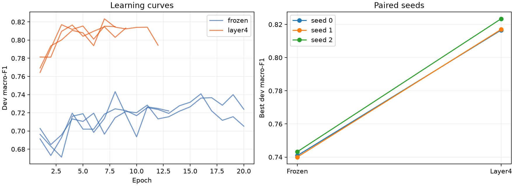
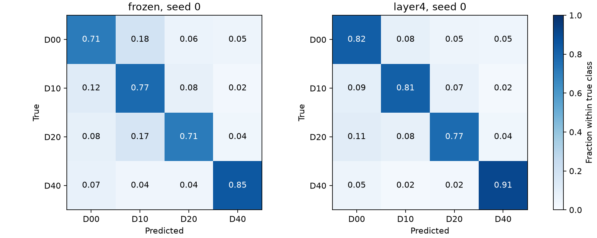
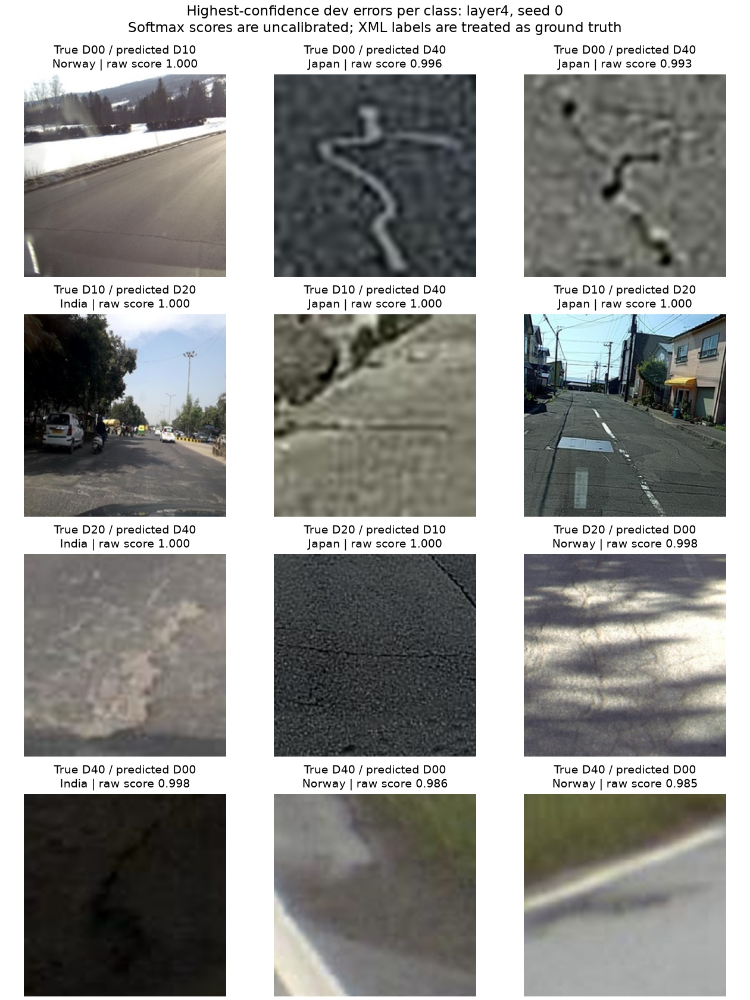

# P3: Layer-4 fine-tuning comparison

Completed paired experiments using the unchanged P2 training script. Only layer4 trainability and its optimizer group differ within each pair.

Seeds: 0, 1, 2. Same source-photo split for every run; final test images were not evaluated.

## Dev results

Values are mean +/- sample standard deviation across seeds (0-1 scale).

| Metric | Frozen ResNet-50 | Fine-tuned layer4 |
|---|---:|---:|
| macro_f1 | 0.7414 +/- 0.0017 | 0.8190 +/- 0.0038 |
| accuracy | 0.7464 +/- 0.0043 | 0.8235 +/- 0.0047 |
| d40_recall | 0.8640 +/- 0.0157 | 0.8782 +/- 0.0288 |
| recall_D00 | 0.7267 +/- 0.0165 | 0.8201 +/- 0.0166 |
| recall_D10 | 0.7322 +/- 0.0366 | 0.7981 +/- 0.0134 |
| recall_D20 | 0.7141 +/- 0.0070 | 0.8119 +/- 0.0355 |
| recall_D40 | 0.8640 +/- 0.0157 | 0.8782 +/- 0.0288 |
| f1_India | 0.5724 +/- 0.0202 | 0.6602 +/- 0.0198 |
| f1_Japan | 0.7041 +/- 0.0128 | 0.8034 +/- 0.0105 |
| f1_Norway | 0.6145 +/- 0.0173 | 0.7087 +/- 0.0179 |

## Paired changes (layer4 minus frozen)

| Metric | Mean change | Sample std |
|---|---:|---:|
| macro_f1 | +0.0776 | 0.0023 |
| accuracy | +0.0771 | 0.0034 |
| d40_recall | +0.0142 | 0.0444 |

## Findings

Layer4 improves dev macro-F1 in 3/3 paired seeds, by a mean 7.76 percentage points. Mean D40 recall changes by +1.42 points; the within-seed changes range from -2.56 to +6.21 points, so inspect the per-seed tradeoff.

These seeds measure training variability on one fixed split, not uncertainty over new photos or countries. A small number of seeds does not establish statistical significance.

## P4 handoff

Selected architecture: **layer4**, using prespecified seed **0**. Selection uses mean dev macro-F1; D40 recall is reported as a separate operational tradeoff.

`selected_dev_logits.csv` and `selected_dev_metrics.json` are copied here for P4. The checkpoint path is recorded in `summary.json`; large checkpoints remain under the ignored `P3/runs/` directory. P4 must fit temperature and review threshold on dev, freeze choices, then evaluate final test once.

## Diagnostics

`comparison.csv` contains every run; `paired_deltas.csv` contains within-seed differences. `dev_errors.csv` contains misclassified dev patches for both variants at the handoff seed. Figures show dev learning curves, paired F1, and normalized confusion matrices.

## Error review (seed 0)

Counts compare layer4 predictions with frozen predictions on the same dev patches.

| True class | Wrong -> correct | Correct -> wrong |
|---|---:|---:|
| D00 | 352 | 108 |
| D10 | 98 | 63 |
| D20 | 151 | 71 |
| D40 | 77 | 26 |

`dev_error_examples.png` shows the three highest-confidence errors per true class for the selected checkpoint. Scores are raw, uncalibrated softmax values; these examples are diagnostic selections, not a representative sample. `paired_dev_predictions.csv` identifies every correction and regression for further inspection.

